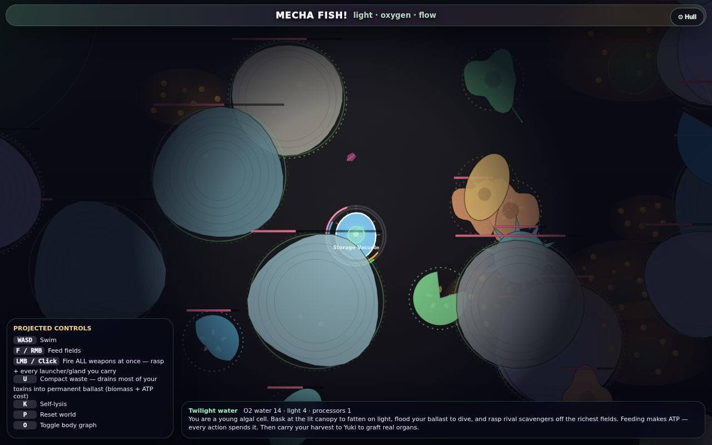
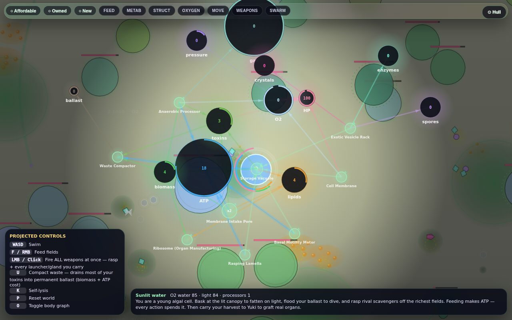
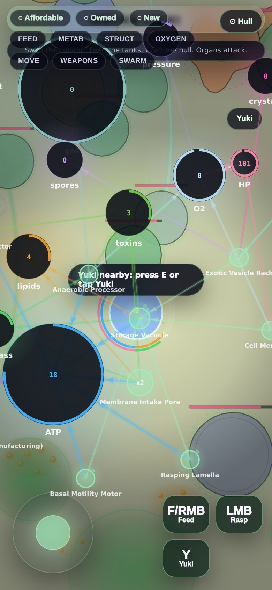

# Eukaryotic Eucharist

Browser games about single cells in a vertical water column. Every ability is an organelle, every
body is a graph, and every death becomes food for the column.

**Play:** https://aquantumarchitect.github.io/eukaryotic-eucharist/



| | Build | What it is |
|---|---|---|
| ▶ [Play](https://aquantumarchitect.github.io/eukaryotic-eucharist/mecha-fish/) | **Mecha Fish!** (v1.3.3, latest) | A mechanical fish in a deep column (2240×7840). Swim the light, oxygen and flow gradients, feed your tanks from drifting fields, and graft organs onto your hull at Yuki's canopy dock. Best on desktop. |
| ▶ [Play](https://aquantumarchitect.github.io/eukaryotic-eucharist/classic/) | **Classic** (v1.3.2) | The last build before the column expansion. Smaller world, a much lighter simulation, and a plain numeric HUD. Plays well on phones. |
| ▶ [Play](https://aquantumarchitect.github.io/eukaryotic-eucharist/immune/) | **Immune Incursion** (prototype) | A sibling game: you are the host immune system. Detect, deploy, clear, remember. Headless Python kernel + a small HTML face. |
| [Archive](https://aquantumarchitect.github.io/eukaryotic-eucharist/#archive) | v1.0 … v1.3.1 | Every snapshot, playable as it shipped. |

<p>
  
  
</p>

## Graph-strict design

The rule everything follows: **every function is an organelle, and bodies act only through
organs.** There are no hidden stats. Movement, feeding, storage, attacks and oxygen tolerance all
come from parts a body actually carries, so the player, the algae, the scavengers and the predators
all run on the same rules. Press `O` in Mecha Fish to see the hull graph: your organelles wired to
the tanks and vitals they feed. Near Yuki the same graph becomes the shop.

- **Kernel owns, page renders.** `src/graph_kernel.mjs` owns fields, bodies, metabolism, oxygen,
  progression, death bloom and the shop. `index.html` only draws the projection the kernel hands it.
  This is why the kernel smoke tests can run headless in Node, and why a
  [Godot 4.5 port](https://github.com/AQuantumArchitect/eukaryotic-eucharist-godot-spike) can render
  the same unmodified kernel through `JavaScriptBridge`.
- **Matter is fields, not coins.** Food is drifting fields with their own physics: biomass sinks by a
  square-cube law, lipids rise and pool at the canopy, and corpses bloom into terrain.
- **No build step.** Plain ES modules and no dependencies. Any static file server runs it.

## Repository layout

```
eukaryotic_eucharist_mobile_v1_0 … v1_3_2   older snapshots, each self-contained (index.html + src/ + tests + design notes)
eukaryotic_eucharist_mobile_v1_3_3          Mecha Fish! — the current game, plus its tuning/ecology tooling
  src/graph_kernel.mjs                      kernel entry (barrel over simCore.mjs + gameModule.mjs)
  smoke_test.mjs                            ~1,350 lines of kernel assertions
  DESIGN_CONSTITUTION_MECHA_FISH.md         product rules; SIM_TUNING_README / ECOLOGY_DIAGNOSIS for the sim
immune_incursion/                           immune incursion prototype (kernel.py, spec.py, index.html, tests)
site/index.html                             landing page for GitHub Pages
tools/                                      cross-platform Node test/site tools, browser_smoke.py, release.ps1
deploy/itch, deploy/electron                itch.io zip packing, desktop wrapper
SPLIT.md                                    why Mecha Fish and Immune Incursion are separate products
```

## Windows development

The canonical checkout is `C:\Users\Luke Spooner\ws-win\eukaryotic-eucharist`. Node 22 LTS and
Python 3 are the supported local toolchain; the repository has no npm runtime dependencies.

## Run locally

```powershell
npm ci
npm start
# open http://localhost:8787/eukaryotic_eucharist_mobile_v1_3_3/  (or any version folder)
```

Controls: WASD / arrows to swim, F or right mouse to feed, E to open Yuki, O for the hull graph.
Touch controls appear on phones. Each version's README lists its full key map.

## Tests

```powershell
npm test                               # every build's headless kernel smoke test + immune unit tests
pip install playwright && python -m playwright install chromium
npm run smoke:browser                  # every build boots in Chromium, plays briefly, no page errors
npm run build:site                     # assemble the Pages site into _site/
.\tools\release.ps1 -Channel html -DryRun -AllowUntagged
```

CI (`.github/workflows/pages.yml`) runs all three on every push and deploys `_site/` to GitHub
Pages from `main`.

## Status and known issues

- **Mecha Fish is heavy.** Measured in Node on one core: about 10–12 ms per kernel step with
  ~160–190 bodies, against ~1.9 ms for v1.3.2 and ~0.4 ms for v1.0. That leaves 1.4–1.7× real-time
  headroom on a desktop and less on phones. Classic is the build to share for mobile.
- **Pacing.** `SIM_TUNING_README.md` documents that the full progression (to the mitochondrial
  Eucharist) is a ~20–30 minute chain that must be built in one life. Death returns you to the
  starter kit (discoveries persist, organs don't), and a fragile cell lasts ~5–8 minutes, so even a
  scripted optimal player rarely reaches the climax. The doc's proposed fix is softening death to a
  checkpoint tier.
- **The no-player ecology** is held up by immigration floors (`ECOLOGY_DIAGNOSIS.md`).

## License

No license has been chosen yet, so all rights are reserved by default. Ask before reusing code or assets.
